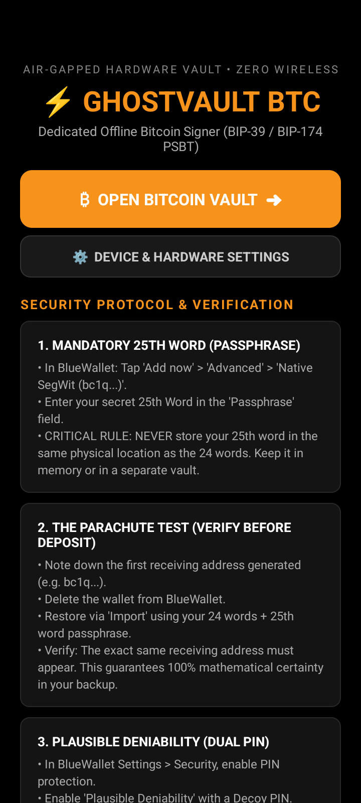
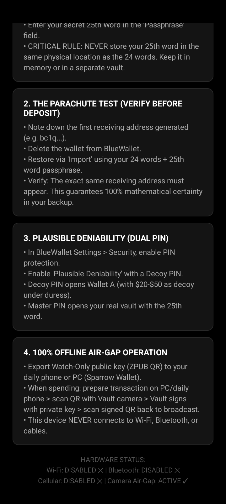

# ⚡ GhostVault BTC — Turn Any Android Phone into a Bitcoin Cold Vault

> **Transform any spare Android smartphone into a dedicated, air-gapped Bitcoin hardware vault (Cold Storage Appliance) featuring mandatory 25th Word (BIP-39 Passphrase) security, Device Owner system hardening, and zero network attack surface.**

[](https://bitcoin.org)
[]()
[]()
[]()

<p align="center">
  
  &nbsp;&nbsp;&nbsp;&nbsp;
  
</p>

---

## 🧭 Philosophy: Elastic, Transparent & Sovereign

Most commercial hardware wallets are expensive, closed black boxes subject to supply-chain tampering and firmware backdoors.

**GhostVault BTC** operates on three core principles:
1. **Elasticity over Rigidity:** This is **NOT** a locked-in, opaque "one-click-only" black box. We provide modular stages (`Debloat`, `Install`, `Hardening`, `Revert`) alongside manual step-by-step instructions. You control every single command.
2. **Pair Programming with AI:** Every phone manufacturer (Samsung, Xiaomi, Motorola, OPPO, Pixel) has slightly different system quirks. We strongly encourage you to collaborate with an AI assistant (Google Antigravity, Claude, ChatGPT, Cursor) to audit the code, tailor package debloat lists, or customize branding.
3. **Pure Optical Air-Gap:** The vault never connects to Wi-Fi, Bluetooth, NFC, or cellular networks. All transactions are prepared on a watch-only device and signed via offline QR codes (BIP-174 PSBT).

---

## 🛡️ Core Capabilities

* 🚫 **RF Air-Gap:** Wi-Fi, Bluetooth, NFC, and Cellular Data are permanently disabled at the kernel and service levels.
* 🔒 **Device Owner MDM Lock:** The custom `GhostKiosk` launcher registers as the official Android **Device Owner**, disabling the status bar pull-down (`StatusBarDisabled`) and policy-locking wireless controls.
* 🛡️ **Hardware Breakout Defense:** Intercepts physical volume keys (`dispatchKeyEvent`) and applies `DISALLOW_ADJUST_VOLUME` to neutralize volume-slider settings breakout tricks.
* ⚙️ **Controlled System Settings Access:** Features a dedicated `[ ⚙️ DEVICE & HARDWARE SETTINGS ]` launcher button for legitimate hardware management (display brightness, screen timeout, lock screen PIN) while keeping Wi-Fi, Bluetooth, and Google cloud accounts permanently locked.
* 📋 **On-Screen Security Protocol Dashboard:** The launcher embeds scrollable dark cards detailing the 25th Word Mandate, the Parachute Test, Dual-PIN Plausible Deniability, and QR Air-Gap rules right on the screen.
* 🧹 **Attack Surface Reduction:** 55+ background trackers, carrier bloat, Facebook analytics, and Google Cloud daemons are stripped for user 0.
* 🔑 **Mandatory 25th Word (BIP-39 Passphrase):** Eliminates single-point-of-failure risks. Even if an attacker physically steals your 24 words, your funds remain mathematically unreachable.
* 🎭 **Plausible Deniability (Dual-PIN Decoy):** Native decoy wallet with a separate PIN for complete protection against the "$5 wrench attack".
* 🔄 **100% Reversible:** No permanent root or bootloader flashing required. You can revert the phone back to a regular smartphone at any time.

---

## 🤖 1-Copy AI Agent Implementation (Recommended)

Don't want to run scripts manually? You can deploy this entire vault by simply copying our Master Agent Prompt into any AI model (**Google Antigravity**, **Claude**, **ChatGPT**, **Cursor**, or **Windsurf**):

👉 **[View Full Master Prompt (AGENT_PROMPT.md)](AGENT_PROMPT.md)**

```markdown
Copy the contents of AGENT_PROMPT.md and paste into your AI assistant:
"Act as GhostVault Engineer. I plugged my spare Android phone into my computer with USB Debugging enabled. Guide me step-by-step through debloating, hardening, deploying the air-gapped vault, and configuring the mandatory 25th word."
```
The AI agent will inspect your specific phone model, generate a custom debloat list, guide you through verification, and answer questions interactively!

---

## 🚀 Quick Start (Automated or Modular)

### Step 1: Prepare the Android Phone
1. On the spare Android phone, go to **Settings > About Phone**.
2. Tap **"Build Number" 7 times** to unlock Developer Options.
3. Open **Developer Options** and enable **"USB Debugging"**.
4. Connect the phone to your PC via USB and accept the trust prompt (*"Always allow from this computer"*).

### Step 2: Choose Your Execution Mode

#### Option A: Interactive Menu (Recommended)
```powershell
.\setup_universal.ps1 -Stage Interactive
```
Prompts you step-by-step to select which stages to execute.

#### Option B: Full Automated Suite
```powershell
.\setup_universal.ps1 -Stage All
```
Automatically debloats, installs BlueWallet and GhostKiosk, applies Device Owner air-gap hardening, and boots directly into the vault.

#### Option C: Modular Stages
```powershell
.\setup_universal.ps1 -Stage Debloat     # Only strips bloatware & telemetry
.\setup_universal.ps1 -Stage Install     # Only downloads & installs vault APKs
.\setup_universal.ps1 -Stage Hardening   # Only cuts radios & locks device owner
.\setup_universal.ps1 -Stage Revert      # Escape hatch: restores phone to stock
```

---

## 🔑 Initializing Your Vault (On the Phone Screen)

1. Tap **"Add now"** -> Select **Bitcoin (₿)**.
2. Tap **"Advanced"** at the bottom:
   * **Address Type:** Choose **"Native SegWit (P2WPKH)"** (`bc1q...`).
   * **Passphrase:** Enter your secret **25th Word**.
3. Tap **"Create"**.
4. Write down the **24 words** on paper or steel.
   > [!IMPORTANT]
   > **NEVER** write the 25th word on the same paper or plate as the 24 words.
5. Tap the **three dots (`...`)** on your new wallet -> **"Show XPUB"** and scan the QR code into your daily smartphone (BlueWallet) or PC ([Sparrow Wallet](https://sparrowwallet.com)) to establish a **Watch-Only** wallet.
6. Unplug the USB cable and toggle **"USB Debugging" OFF** in Developer Options.

---

## 📚 Deep-Dive Documentation

* 🤖 **[Master AI Agent Prompt (AGENT_PROMPT.md)](AGENT_PROMPT.md):** 1-copy prompt to turn any LLM or coding agent into your personal vault setup engineer.
* 📖 **[The 25th Word Guide (THE_25TH_WORD_GUIDE.md)](THE_25TH_WORD_GUIDE.md):** Detailed guide to BIP-39 Passphrases, decoy wallets, and the dry-run parachute test.
* 🛡️ **[Security Audit & Threat Model (SECURITY_AUDIT.md)](SECURITY_AUDIT.md):** In-depth technical breakdown of all attack surfaces, Android MDM policies, and physical protections.
* 🤖 **[AI Pairing & Customization Guide (AI_PAIRING_GUIDE.md)](AI_PAIRING_GUIDE.md):** How to pair with AI coding assistants to customize debloat lists, troubleshoot ADB, or swap signing software.

---

## 📂 Repository Structure

```text
ghostvault-btc/
├── .cursorrules                 # Autonomous agent instructions for Cursor & IDEs
├── .github/copilot-instructions # Instructions for GitHub Copilot
├── AGENT_PROMPT.md              # Copy-paste master prompt for any LLM assistant
├── setup_universal.ps1          # Modular, interactive PowerShell hardening suite
├── debloat_oppo.ps1             # Reference debloat list for ColorOS / OPPO
├── THE_25TH_WORD_GUIDE.md       # In-depth guide to BIP-39 Passphrase & PSBT
├── SECURITY_AUDIT.md            # Full technical audit & defense-in-depth model
├── AI_PAIRING_GUIDE.md          # Guide on tailoring the vault with AI assistants
├── kiosk_app/                   # Pure Java Android Kiosk / Device Owner app
│   ├── src/main/java/           # KioskActivity.java & AdminReceiver.java
│   ├── src/main/res/            # Layouts & device_admin.xml policies
│   ├── build_kiosk.ps1          # Standalone APK compilation script
│   └── build/GhostKiosk.apk     # Pre-built & signed APK ready to deploy
└── README.md
```

---

## ⚠️ Disclaimer & Open-Source Philosophy
GhostVault is free, open-source software built for the sovereign Bitcoiner. Always test your recovery phrase with the dry-run parachute test before transferring significant funds. You are your own bank.
