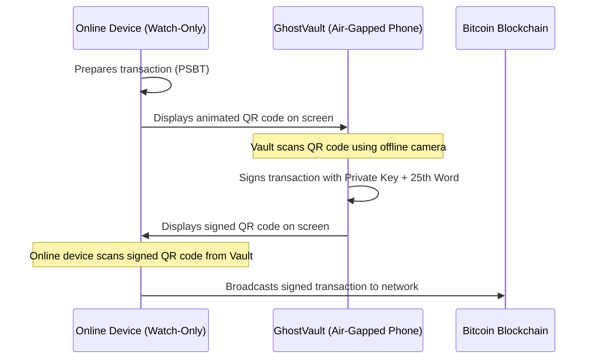

# 🔑 The 25th Word (BIP-39 Passphrase) — Mandatory Vault Security

> **In a standard Bitcoin setup, anyone who discovers your 24-word seed phrase controls 100% of your Bitcoin. The 25th Word (BIP-39 Passphrase) fundamentally solves this problem.**

---

## 🛡️ What is the 25th Word and Why is it Mandatory?

Under the Bitcoin BIP-39 standard:
1. The **24 words** come from a standardized list of 2048 words.
2. The **25th Word (Passphrase)** is an extra word, passphrase, or string invented entirely by you (e.g. `S0v3reign!H0dl#2026`).
3. It acts as an **additional cryptographic salt** passed into the key derivation function (PBKDF2 with HMAC-SHA512).

### The Mathematical Magic of the Passphrase:
* **Seed Alone (24 words):** Derives **Wallet A** (a completely valid, functional Bitcoin wallet).
* **Seed + Your Passphrase (24 words + 25th word):** Derives **Wallet B** (an entirely separate, mathematically unlinked wallet).
* **Seed + Any other typo:** Derives **Wallet C, D, E...**

> [!IMPORTANT]
> **There is no "Incorrect Password" prompt in Bitcoin.**  
> Every passphrase creates a valid wallet. If someone steals your 24-word paper backup, without your secret 25th word, they cannot even calculate whether your real wallet exists.

---

## 🎭 The "Plausible Deniability" (Decoy Wallet) Defense

The 25th word provides the ultimate defense against physical coercion, extortion, and the classic "$5 wrench attack":

1. **The Decoy Wallet (Wallet A):**
   * Restore the 24 words **without** any passphrase.
   * Deposit a small, believable amount (e.g., $20 or $50 in Satoshis) and make a couple of real transactions.
2. **The True Vault (Wallet B):**
   * Restore the 24 words **with** your secret 25th word.
   * This is where your long-term savings reside.
3. **Under Duress:**
   * If coerced by an attacker or inspector, surrender the 24 words and unlock Wallet A.
   * The attacker sees a real wallet with valid blockchain history and funds.
   * It is **mathematically impossible** for anyone to prove that Wallet B exists.

---

## 📝 Step-by-Step Vault Initialization on Device

Follow these exact steps on your air-gapped phone screen (in BlueWallet):

### Step 1: Create New Wallet
1. Tap **"Add now"** (or the `+` icon in the top right).
2. Enter a discreet wallet name (e.g., `Cold Vault` or `GhostVault`).
3. Make sure **Bitcoin** (orange ₿ icon) is selected.

### Step 2: Enable Advanced Mode & Enter the 25th Word
1. Before tapping "Create", tap the blue text **"Advanced"** at the bottom of the screen.
2. **Address Type:** Select **"Native SegWit (P2WPKH)"** (addresses start with `bc1q...` — highest security, modern standard, lowest transaction fees).
3. **Passphrase field:** Type your secret **25th Word**.
   > [!WARNING]
   > The passphrase is case-sensitive and space-sensitive (`Secret123` ≠ `secret123`). Choose something memorable to you, and practice typing it. If you forget it, the funds are unrecoverable.

### Step 3: Record Your 24 Words
1. Tap **"Create"**.
2. Write down your **24 words** on paper or punch them into a stainless steel plate in exact numerical order (1 through 24).
3. **THE GOLDEN RULE OF SEPARATION:**
   * **NEVER write the 25th word on the same paper or plate as the 24 words.**
   * Keep the 25th word in your memory, or in a completely separate physical location.

---

## 🪂 The Parachute Test (Dry-Run Recovery)

**NEVER deposit substantial funds into any Bitcoin wallet without testing recovery first:**

1. On your newly created wallet, tap **"Receive"**.
2. Note down the first and last 6 characters of the generated address (e.g., `bc1q9w...4x8k`).
3. Go back, tap the **three dots (`...`)** inside the wallet settings.
4. Scroll to the bottom and tap **"Delete wallet"** (confirm deletion).
5. Now perform the true recovery test:
   * Tap **"+"** -> **"Import wallet"**.
   * Enter your **24 words** in order.
   * Tap **"Advanced"** -> enter your **25th word**.
   * Tap **"Import"**.
6. Open the restored wallet and tap **"Receive"**:
   * **The Proof:** If the address matches `bc1q9w...4x8k` exactly, you have verified with 100% mathematical certainty that your backup is error-free.

---

## 👁️ Setting Up a Watch-Only Wallet on Your PC / Daily Smartphone

You never need to plug your cold vault into the internet to check balances or receive Bitcoin:

1. On the **GhostVault (Air-Gapped Phone)**:
   * Open your wallet -> tap the **three dots (`...`)**.
   * Select **"Show XPUB"** (or Export Public Key / ZPUB).
   * A **public QR code** appears on screen.
2. On your **daily phone (BlueWallet) or PC (Sparrow Wallet)**:
   * Select "Add Wallet" -> "Import".
   * Scan the QR code displayed on the GhostVault.
3. **Result:**
   * Your connected device now has a **Watch-Only** wallet.
   * ✅ Check balance anytime.
   * ✅ Generate new `bc1q...` receiving addresses.
   * 🛡️ **Zero Risk:** Even if your daily phone is infected with malware, **no one can spend your Bitcoin**, because the private keys remain permanently air-gapped on the GhostVault.

---

## ✍️ How to Spend Offline via QR Code (PSBT)

1. Prepare the transaction on your online device (PC/daily phone) -> Click "Create PSBT" -> Displays a QR code.
2. Open camera in GhostVault -> Scan the QR code.
3. GhostVault signs the transaction with your private key -> Displays the signed transaction QR code.
4. Scan the signed QR code with your online device and broadcast to the Bitcoin network.
